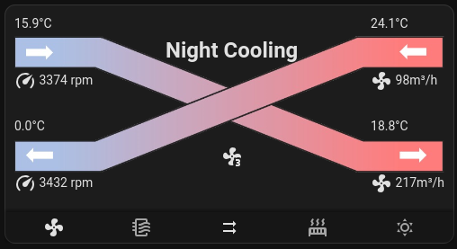

# Homeassistant Lovelace HVAC card

It's a fork from https://github.com/wichers/lovelace-comfoair to use with other ventilation unit.

Use https://github.com/kanocz/modbus2mqtt to connect your ventilation unit to Homeassistant and then use this lovelace card to visualize your data!



# Installation

* Clone this repo into your `www` folder inside your configuration. So it will be: `config_folder/www/lovelace-hvac`. 
* Edit your lovelace-ui.yaml or use the flat configuration mode in lovelace and add to the top:
```
resources:
  - type: module
    url: /local/lovelace-hvac/hvac-card.js
```
* Add a card with `type: 'custom:hvac-card'` to your UI.
* Reload home assistant
* ???
* Profit!

The card fits the width of its dashboard column. On cards up to 360px wide,
the operating state moves above the airflow diagram to leave room for the readings.
The diagram is an inline SVG: it stays sharp as the card resizes and does not
need a separate image file or depend on the installation directory name.
Click or tap any temperature, fan RPM, or airflow reading to open that sensor's
standard Home Assistant more-info dialog, including its history when recorded.
The readings also support Tab, Enter, and Space.

After updating, refresh the browser or Companion App frontend cache to load the
new JavaScript. No card configuration changes are needed.

## Browser checks

Serve the repository with a static HTTP server and open
[tests/hvac-card.html](tests/hvac-card.html). It checks the inline SVG without PNG requests,
entity events across shadow roots, live updates, and layout at widths from 280 to 800px using stub Home Assistant
card/icon elements. It uses the same Lit CDN import as the card, so internet access
is required. The actual more-info dialog and recorded history need a Home Assistant
instance to verify.
